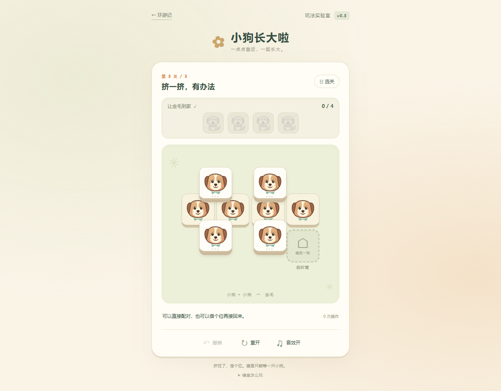
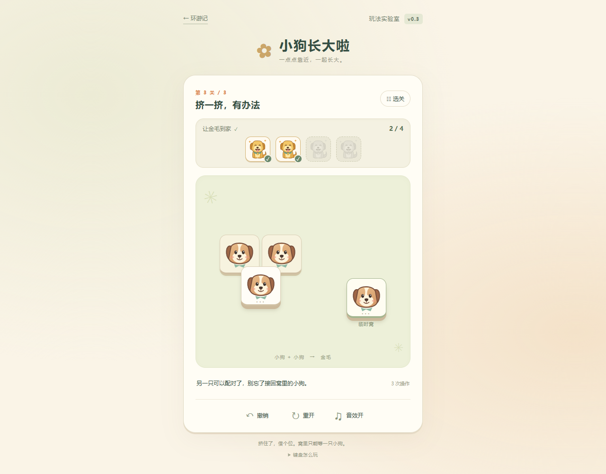
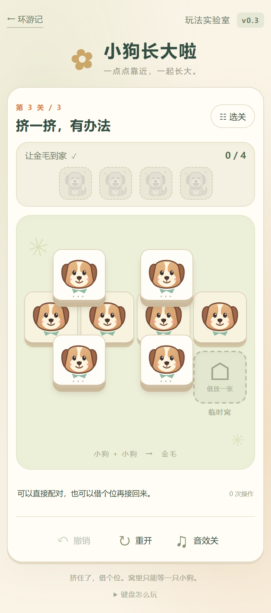

# v0.3 小狗长大啦：叠合与单格借位

规则修订日期：2026-10-20；交互与结构整理日期：2026-10-21。

分支：codex/v0.3-diagonal-merge。当前规则版本：merge-v03-2。

状态：借位规则修订已在 2026-10-20 完成验证。2026-10-21 的交互与代码整理已通过统一自动检查和主模式、静态 H5 浏览器复测，实现已推送并建立 [PR #2](https://github.com/ApoTuT/Tile-Explorer/pull/2)，尚未合并或正式发布。本轮证据见第 10 节。

## 1 本轮为什么要改

上一轮第三关的开局确实存在可行解，但玩家先把右侧两张上层牌分别合成后，会剩下“两张下层小狗同时被上下两张小狗压住”的四牌局面。两张下层都还有另一张挡牌，旧规则不允许任何一次合成。用户截图中的状态确实是死局，问题不在于没有把牌拖准。

原先只能用撤销或重开处理它，这不足以回应“在棋盘上继续解开”的体验要求。本轮增加一个固定的单张临时窝：把一张上层小狗先借放进去，解除它的遮挡，再完成其他合成，最后把窝里的小狗接回来配对。同时收紧下层牌之间的空隙，使牌阵更像一个整体。

本轮不把“开局有一个解”当作充分验收。首三关的每个合法可达状态都必须仍能通关，才能宣称修订消除了这类无法继续的残局。自动化能证明操作和规则一致，不能证明玩法已经好玩；后者仍需玩家试玩。

## 2 玩家做什么

玩家提起一张上层小狗，拖到可用的下层小狗上，两张对齐后长成金毛并自动到家；暂时没有落点时，可以先把一张小狗拖进临时窝借个位。

| 操作 | 规则与反馈 |
|---|---|
| 合成 | 上层或窝内的小狗，拖到同类下层小狗上；目标不能再被其他上层牌压住 |
| 借位 | 上层小狗可拖进空临时窝；离开牌阵后不再遮挡下层 |
| 从窝取回 | 窝内小狗只能拖到合法下层目标完成合成，不可任意摆回空地 |
| 窝已占用 | 不能再放第二张，也不自动交换；必须先完成窝内小狗的配对 |
| 无效落点 | 松手回位，牌阵、操作数、目标和历史都不改变 |
| 撤销 | 恢复上一整次借位或合成，包括窝占用、材料、目标和操作数 |
| 重开 | 恢复本关固定初始布局 |

三关都开放临时窝。借位和合成都各记一次有效操作，没有倒计时，不限制最优操作数。临时窝没有次数、能量或收费机制。

这一格是明确、有限的棋盘位置。它增加了“先放哪一张、何时接回来”的选择，不开放把牌随意停在任何空白处，也不直接替玩家消除挡牌。

## 3 统一规则

### 3.1 牌层与遮挡

牌面逻辑尺寸为 100×100 世界单位，上层 z=1、下层 z=0。同层牌不得重叠。高层与低层矩形有正面积交集即形成遮挡，边缘相接不算。

下层小狗承担配对落点的作用，不能单独拿起。上层可拖小狗与窝内小狗应有清楚的可操作反馈。窝内牌已经离开牌阵，不参与遮挡计算。

合成时，目标下层牌只能被当前源牌压住，或完全无遮挡。它如果还被另一张上层牌压住，就不能隔着那张牌合成。窝内源牌本身不挡目标，因此其目标必须已经完全露出。

### 3.2 对齐、成长与交付

同类部分错位叠放允许存在，玩家必须手动完成拖放。完整对齐且满足落点条件后立即合成，不保留“上下已经重合却等待再点击”的稳定局面。拖动经过目标不结算，松手确认后才提交。

一对小狗消耗两张材料，产出一只金毛。金毛短暂长大后自动飞进目标槽，不成为下一次合成材料。完成目标并收完所有材料即通关，窝内也不能遗留材料。

首版仅使用小狗到金毛这一条成长关系，不同时加入其他动物或多级升级。

### 3.3 拖动路径

拖动表达把牌提起，不计算途中与其他牌的碰撞，也没有隐藏距离或方向锁。牌位自然引导斜拖，玩家不必精确沿一条轨迹移动。

放进窝和从窝拿回都使用同一套拖放输入。不把“解围”做成替玩家选择牌的一键按钮。正常轻点小狗不提交操作；键盘辅助调用同一规则内核。

## 4 紧凑牌阵与可见信息

第二、三关的相邻下层牌间隔统一为 6 世界单位。下层之间不再留出原先的大块空白；错位的上层仍保留足够露出，避免把“紧凑”做成猜图案。

识别检查使用真实矩形遮挡的并集。关键下层露出至少 50%，中央 30×30 的双眼与鼻子识别区域至少 80% 可见，另做实际截图检查。几何可见不等于陌生玩家一定认得出。

| 参数 | 当前设定 |
|---|---|
| 牌面 | 100×100 世界单位 |
| 下层间隙 | 第二、三关为 6 世界单位 |
| 起拖阈值 | 6 CSS 像素 |
| 合成吸附 | min(42, max(28, 20 / 棋盘缩放)) 世界单位半径 |
| 无效落点回位 | 150 毫秒，可被新手势取消 |
| 临时窝 | 一个固定位置，只容纳一张牌，随棋盘统一缩放 |
| 布局边界 | 初始牌阵与临时窝共同确定；合成后不重新居中缩放 |
| 信息要求 | 目标牌图案实际露出，不展示设计者才知道的隐藏答案 |

下列坐标是左上角。临时窝也为 100×100，属于独立容器，不是第三层牌。它始终保留在画面中，不遮住可落点。

## 5 当前三关设计

三关递进从直接配对、学会借位，到在更大的牌阵中组合两种动作。学习跨度不等于强制玩家只操作一、二、三次。

### 5.1 第一关：靠近一点

目标一只金毛。保留一组松散错位的上下小狗，并提供一个可选临时窝。

| ID / 容器 | x | y | z |
|---|---:|---:|---:|
| u1 | 40 | 40 | 1 |
| l1 | 105 | 80 | 0 |
| 临时窝 | 235 | 80 | — |

最直接的路线是 u1 → l1。玩家也可以先把 u1 放进窝，再从窝拖向 l1；两条路线都应能完成。第一关不要求为了使用新工具而多走一步。

### 5.2 第二关：借个位，再回来

目标两只金毛。上下两张小狗同时压住左右两张下层牌，开始时不能直接合成，临时窝成为玩家需要使用的新动作。

| ID / 容器 | x | y | z |
|---|---:|---:|---:|
| l0 | 0 | 160 | 0 |
| l1 | 106 | 160 | 0 |
| u1 | 53 | 80 | 1 |
| u2 | 53 | 240 | 1 |
| 临时窝 | 230 | 160 | — |

一条参考路线：

1. 把 u1 拖进临时窝，解除它对两张底牌的遮挡。
2. 把 u2 拖到 l0，合成第一只金毛。
3. 把窝内 u1 拖到 l1，完成第二只金毛，临时窝随之腾空。

这里教的是“借出一张，再接回来”，不是记住一条唯一答案。另一张上层先借位、选择另一个下层作为配对目标，也应可通关。

### 5.3 第三关：挤一挤，有办法

目标四只金毛。四张下层横向排成一行，每张间隔 6。左组上层同时压住两张下层，右组压住一张下层，最右侧留有一个不受遮挡的配对落点；临时窝位于右下空区。

| ID / 容器 | x | y | z |
|---|---:|---:|---:|
| l2 | 0 | 160 | 0 |
| l3 | 106 | 160 | 0 |
| l1 | 212 | 160 | 0 |
| l0 | 318 | 160 | 0 |
| u2 | 53 | 80 | 1 |
| u3 | 53 | 240 | 1 |
| u1 | 218 | 80 | 1 |
| u4 | 218 | 240 | 1 |
| 临时窝 | 318 | 270 | — |

不借位的一条路线仍是 u2 → l0、u3 → l2、u1 → l3、u4 → l1。它让熟悉规则后看出顺序的玩家，用更少的操作完成。

玩家如果先走 u1 → l0、u4 → l1，会剩下用户截图中的四牌结构。新规则下可以继续：

1. 把 u2 放进窝。
2. 把 u3 拖到 l2。
3. 把窝内 u2 拖到 l3。

不需要撤销此前两只金毛，也不偷偷换牌。这条续解已经过实际运行内核、桌面拖放与触控模拟验证。

## 6 运行内核与模块边界

沿用原生浏览器 JavaScript 和 DOM 牌面，不迁移游戏引擎。规则与显示完全分离，Node 验关和浏览器使用同一套内核。

| 文件 | 职责 |
|---|---|
| web/merge-v03/geometry.js | 矩形、遮挡并集、可见区域和固定边界 |
| web/merge-v03/engine.js | 借位、合成、结算、操作计数、事务、撤销、回放与求解 |
| web/merge-v03/levels.js | 三关静态坐标、临时窝与参考路线 |
| web/merge-v03/settings.js | 拖动阈值、吸附和表现时长，集中手感参数 |
| web/merge-v03/session.js | 唯一持有稳定状态和操作历史，提交、撤销、恢复与保存 |
| web/merge-v03/input.js | Pointer Events、捕获、抓取偏移、吸附与取消 |
| web/merge-v03/view.js | 按 ID 复用牌、目标和固定临时窝节点，布局与落点反馈 |
| web/merge-v03/presentation.js | 短促的借位、成长和交付表现及取消 |
| web/merge-v03/storage.js | 独立存档、合法回放恢复与兼容迁移 |
| web/merge-v03/app.js | 组合各模块，协调页面生命周期、选关和设置 |
| config/merge-v03.json | 服务与导出共用的入口、脚本顺序、样式和素材清单 |
| tile_explorer/assets.py | 验证规范资源路径、类型、重复项与 HTML 引用顺序 |
| tools/checks.py | 本地和 CI 共用的完整开发检查入口 |
| tools/validate_v03_levels.cjs | 用真实内核枚举可达状态并验关 |
| tools/playtest_v03.cjs | 可选浏览器实际操作、异常恢复与截图 |
| tools/export_v03.py | 导出必要的本地文件为静态 H5 |

稳定状态记录关卡身份、定义哈希、规则版本、存活材料、窝内材料、交付数、有效操作数、revision 与状态。纯内核不访问 DOM、音频、时间、网络或 localStorage。

借位和合成都由 GameSession 通过统一入口提交。会话持有稳定状态和完整历史，app 不再维护另一份历史。一次事务包含操作前后的完整稳定状态及动作信息，撤销不只恢复一张牌；表现事件不承担规则状态。规则和坐标变化后，定义哈希及验关报告随之更新。整体维护入口见 [项目架构](../ARCHITECTURE.md)。

新模式不调用原 Python Game.pick()，也不复用原七格三同消除证书。原九关继续由原 Python 内核负责。

## 7 交互、表现与生命周期

输入使用 Pointer Events，覆盖鼠标、触屏和触控笔。起手记录 pointerId、抓取偏移、统一变换和 revision；超过阈值后显示抬起的拖动牌。pointermove 合并到 requestAnimationFrame，使用 translate3d 更新拖动位置；同一目标资格未变时不重复刷新高亮。松手使用释放瞬间坐标重新选择落点，再次调用内核校验，不沿用上一帧的旧坐标或绿色高亮。

吸附容错兼顾世界距离与屏幕缩放，半径限制在 28～42 世界单位；最小屏幕容错目标为 20 CSS 像素。无效落点用 150 毫秒短动画回原位，新手势、取消和页面变化都能立即清理它；残影不进入规则。参数集中在 settings.js。

窝空时给出可以借放的轮廓，窝满时清楚显示其中的小狗。窝内小狗仍有抓取反馈；玩家尝试放第二张时，给出短促的占用反馈并回位，不弹出阻断窗口。

pointercancel、丢失捕获、第二根手指、滚动、调整窗口、隐藏、切关都会安全取消未提交拖动。棋盘在屏幕上移动而自身尺寸没有变化时，也必须重新计算指针变换。

成功操作先提交稳定规则和存档，保留当前原生触控结束事件所需的帧交接，再更新节点。只有这次提交交接暂时锁住输入；成长与交付动画不阻止下一次抓牌。新手势可以取消旧表现，动画结束不再全量 render，避免打断新拖动。撤销、重开、选关和隐藏仍能取消表现，旧回调不得重复交付。

View 按牌 ID、目标序号和固定窝节点复用 DOM，更新时只增删必要节点；窗口变化更新布局，不反复重建整副牌。Presentation 用 transform 和 opacity 播放吸附、成长与交付；减少动态效果或缺少 WebAnimations 时直接完成视觉末态，不阻止已经提交的规则。

金毛继续采用短促成长与飞入目标的反馈，借位应表达“把小狗先安置在旁边”，不播放成品交付效果。减少动态效果、关闭声音或音频不可用时，操作结果完全相同。

素材使用本地原创 puppy.svg 与 golden.svg，成长前后有清楚轮廓差异；dog.wav 复用原短音。键盘可以选择源牌、目标或临时窝并确认，执行同一规则，不增加独立玩法。

## 8 存档与旧残局兼容

进度、进行中状态和音效设置使用独立的 tile-explorer.merge.v03.* 存储空间，不与原九关成绩混用。保存已提交操作和规则、定义身份，刷新时用实际内核回放，重建完整撤销历史。拖动预览和表现对象不写入存档。

本轮不简单地把所有旧局面重置掉。仅对已知旧 ruleset 与定义哈希，尝试在新关卡和新内核下合法回放旧合成记录：

- 第一、三关遮挡拓扑兼容，旧操作能合法回放时，保留材料、交付和可撤销历史，并映射到紧凑新坐标。
- 用户截图对应的第三关四牌残局应保留下来，让玩家直接用临时窝续解。
- 第二关新布局需要先借位。旧合成记录如果无法在新定义下合法回放，就退回该关新初始，并给出简短的规则更新说明。
- 不复制新规则下不合法的旧事务，不把旧规则完成记录直接当作新规则完成。

损坏、不认识或不兼容的记录安全回退，不阻止开局。localStorage 不可用时保留本次内存状态并说明无法保存到设备，不影响规则和通关。

## 9 可解性标准与独立 H5

### 9.1 不只验证一条开局答案

每个关卡必须先通过材料、同层重叠、初始稳定性、临时窝位置、实际可见区域和参考路线检查，然后枚举全部合法可达状态。

搜索状态必须区分窝中是哪张牌，不能只用存活 ID 集合去重。后继操作包含合成与借位。对每个可达状态再次求解，要求都能完成目标；“无解状态数为零”才满足本轮三关的发布条件。

求解结果仍区分已找到解、完整探索后证无解、预算中断尚未验证。预算中断不得计为通过。本轮关卡小，要求完整枚举；结果登记在 [实际关卡报告](v0.3-level-report.json)。

本轮实际内核已生成以下完整枚举结果。可恢复状态包含已经通关的状态。

| 关卡 | 可达状态 | 仍可通关的状态 | 无解状态 | 最短操作数 | 定义哈希 |
|---|---:|---:|---:|---:|---|
| 第一关 | 3 | 3 | 0 | 1 | 6b299847 |
| 第二关 | 8 | 8 | 0 | 3 | dc35470b |
| 第三关 | 74 | 74 | 0 | 4 | 0bdf5b8e |

三关的 allReachableSolvable 均为 true。第二关两张下层均露出 81.2%；第三关 l0 露出 100%、l1 62.4%、l2/l3 81.2%；所有中央识别区域 100% 可见。

这项保证仅覆盖当前三关与当前规则。后续新增图案、第三层或其他动作后，需要重新验证，不把旧保证扩展到未测试的新机制。

### 9.2 静态运行

新入口为 /merge-v03.html，脚本、图片和声音使用相对路径，不请求 Python 玩法 API，也不依赖外部 CDN。共享资源清单 config/merge-v03.json 当前登记 17 个文件，服务白名单和静态导出共同读取，导出前交叉核对 HTML 引用顺序。

~~~text
python main.py
python tools/export_v03.py --output .local/h5-v03
python -m http.server 8767 --bind 127.0.0.1 --directory .local/h5-v03
~~~

第一行启动原服务，可从首页进入新模式。后两行导出并启动独立 H5，访问 http://127.0.0.1:8767/。导出脚本只复制明确清单，不发布到网络，也不递归删除已有目录。

原九关仍需要本机 Python 服务；新三关可以在普通静态 HTTP 环境运行。直接双击 file 协议页面的音频限制不属于已经通过的静态托管验证。

## 10 验证与提交记录

2026-10-20 的借位规则修订通过 54 项 Python、91 项 JavaScript、桌面、触控模拟和独立 H5 检查。它是前一轮证据。本轮仍使用 merge-v03-2，但按交互与结构改动重新验证。

2026-10-21 本轮实际验证结果：

| 验证 | 本轮状态 |
|---|---|
| 全部 Python 回归 | 57 项通过，含规则、HTTP、资源清单、HTML 引用和导出 |
| 全部 JavaScript 回归 | 9 个测试文件共 113 项通过，包含空白落点回归 |
| 全部网页 JS 语法、空白检查 | 通过 |
| 三关逐状态可解检查 | 3 / 8 / 74 个状态全部可恢复，无解状态均为零，见 [关卡报告](v0.3-level-report.json) |
| 17 文件静态 H5 导出 | 通过资源与 HTML 一致性校验 |
| 释放瞬间坐标、帧合并、回位取消、会话与节点复用 | 自动测试通过；浏览器确认释放点重新采样、回位表现与节点复用 |
| 连续拖动、旧表现取消、桌面/触控/键盘与窄视口 | 主模式及静态 H5 通过，可在旧表现结束前开始下一手；触控模拟确认偏离中心 18 CSS 像素仍可吸附 |
| 完整撤销、刷新、旧残局兼容、原九关与静态 H5 试玩 | 通过；第二关完整三步撤销，键盘借位后焦点转到 u2，旧第三关四牌局面刷新后仍可续解；原九关入口与取牌正常 |
| GitHub 提交、推送与 PR | 实现已推送，[PR #2](https://github.com/ApoTuT/Tile-Explorer/pull/2) 已创建且未合并；目标为 feat/v0.2-tray-theater，远程 CI 结果以 PR 页面为准 |

首轮远程 CI 因实现提交未附关卡报告而失败；报告随本轮验证文档纳入，最终结果以 PR 最新提交的复跑为准。

本地与 CI 的统一检查入口：

~~~text
python tools/checks.py
node tools/playtest_v03.cjs
~~~

Playwright 与 Edge 只是可选开发检查工具，游戏本身不需要 Node 或 npm 依赖。V03_URL 指定实际预览地址，PLAYWRIGHT_MODULE 可指向已有 Playwright，V03_STATIC=1 检查纯静态导出。截图和原始报告默认输出在 .qa/v03，可用 V03_QA_OUTPUT 分开不同检查的输出。本轮主模式原始目录为 .qa/v03-polish，纯静态目录为 .qa/v03-polish-static，避免相互覆盖。

[浏览器报告](v0.3-browser-report.json)、[静态 H5 报告](v0.3-static-report.json) 和下方截图已更新为本轮复测证据。两份报告的错误列表均为空，覆盖 320×568、360×780、390×844、768×1024、1280×1000 视口；桌面与 390 宽触控截图经人工查看无界面重叠。

这次浏览器测得主模式释放到可开始下一手为 4.7 毫秒、静态为 5.5 毫秒；这是本机单次观测，不能作为所有设备的性能保证。原始 CDP 触控脚本每个移动步骤留 16 毫秒，并在手势后等待 1000 毫秒，让浏览器完成原生手势处理；这只是自动化等待，不是游戏中的操作冷却。

## 11 后续体验判断

Android/iOS 实机、陌生玩家无指导试玩及真实音频听感仍需验证。重点观察玩家能否发现临时窝、理解窝满后先接回、在截图四牌局面继续操作，以及是否觉得借位带来有意思的选择。

当前仍是三关原型，没有完成比赛所需的 50 关，也没有证明玩法已经上瘾。后续优先围绕下层排列、遮挡关系、可用落点和借位时机扩展少量关卡；如果玩家总是无脑先借位，应先改关卡和动作反馈，再讨论新增规则。

参考资料：[比赛创作指南](https://learnings.feishu.cn/docx/WlV6dSR3EoiaXOxywiacKCqcnTb)、[项目说明](../../README.md)、[v0.2 实现](v0.2.md)、[版本约定](../VERSION_CONTROL.md)。
