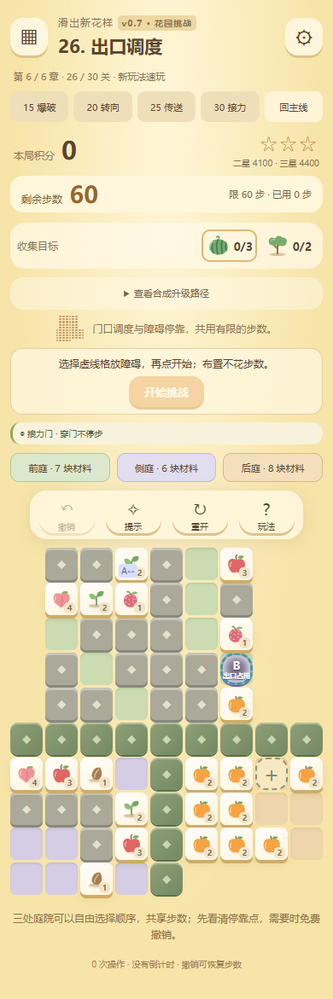

# v0.7 花园挑战：30 关重排

这次版本回应“整体太容易”和用户提供的开心消消乐截图：参考的是异形轮廓、区域封锁、材料密度和多目标的阅读层次。保留本作的四向滑动与二合一规则，使用本作现有图案，不复制参考游戏的美术或三消规则。

后半段的设计目标是不看提示首次解开约需 5–10 分钟，允许反复免费撤销。该时间是目标，尚未做陌生玩家计时试验；最短步数、规划长度和机关必要性有程序验证。

## 关卡结构

1–14 关是紧凑的空间问题：材料先充当停靠点，再参与合成。不是把答案绕远，而是从完整状态图筛选必须多次挪位的开局。不同形状的材料占据真实空间，不能穿过不够宽的通道。

15–30 关采用三庭院布局。三处庭院可自由选择顺序，共享整关步数，各庭院内部包含升级路线、窄路和封锁。它们之间没有隐藏的强制顺序，也不能跨庭院搬材料；地形分隔是可见的。该设计将多个需要思考的局部问题组成一张更丰富的大棋盘，避免简单增加重复点击。

第 15 关首次加入爆破；第 20 关首次加入转向花台；第 25 关首次加入传送门。三个节点保留清楚的机制入口，但入口所在的整关也包含需要规划的庭院。后续将机关组合到同一条路线中，终关保留穿门、转向、合成、爆破接力。

机关必须改变能否通关：关闭任何一项本关声明的机关后，至少一处庭院在不限步数时也无法完成。空爆可以导致死局，免费撤销用于恢复；不承诺任意操作后都仍可解。

## 难度证据

`tools/v07_difficulty.cjs` 使用线上同一个引擎枚举全部空间状态，建立反向边，从胜利状态反向广度优先搜索。距离是严格最短成功操作数，障碍初始放置不计步。升级、交付、爆破标记、剩余木箱、花台、传送门、障碍位置和剩余挪动次数均参与状态。

预算与分数不决定空间转移，因而不进入距离图。最短解得到后，另外用真实预算重放整条路线，验证通关、积分与三星门槛。既有在线提示搜索使用启发式，不能被当作最短解证明。

额外记录挪位数、最长连续准备、局部决策点及贪合成陷阱。决策点表示至少三个合法后继且最短后继不超过约四成；贪合成陷阱表示眼前有不能缩短到终点距离的合成，而正确选择需要先挪位。这些是路线证据，不是对真人难度或趣味的证明。

对于三庭院，`tools/v07_regions.cjs` 检查所有开放格归属、边界隔离、完整大块尺寸、花台范围及传送端点。每次成功操作只能改变一个庭院，庭院之间不能移动、合成或传播爆炸。因此整关最短解等于各庭院严格最短解之和。报告记录的是庭院内决策统计，不能解读为全局“唯一正确选择”的数量。

资源上限或超时一律返回未验证，不能写成有解、无解或无捷径。上线关卡必须有完整图证明和整关实际重放。

## 生成与复核

- `tools/fixtures/v07-challenge-seeds.json`：已筛选的紧凑关卡与既有机关结构。
- `tools/fixtures/v07-planning-rooms.json`：本轮新生成并筛选的主庭院。
- `tools/fixtures/v07-side-rooms.json`：16 处各不相同的侧庭新题，避免复用前面关卡的完整题面。
- `node tools/build_v07_challenge.cjs`：从版本化素材重建 30 关，计算每个庭院的严格最短解（`author_v07_levels.cjs` 曾是它的转发别名，已移除）。
- `node tools/validate_v07_levels.cjs --write`：独立复核几何隔离、最短距离、机关移除实验、分数和预算，输出 `v0.7-challenge-level-report.json`。
- `node tools/search_v07_rooms.cjs`：离线探索新布局，按固定种子生成；候选接受受资源预算影响，正式复现以已入库素材为准。

## 交互与存档

大型棋盘用三种地面色区分庭院，顶部显示各庭院剩余材料数，点击可定位。说明可展开，撤销工具随页面滚动保留可达性。手机保留触控目标，不以缩到难以点击来塞满屏幕；小屏可以纵向滚动。

存档上限改为该关真实步数预算，加上可选的障碍初始放置，支持超过 21 次操作的刷新恢复。撤销完整恢复材料、机关、分数及步数，无次数限制。同一站点内，旧版本已解锁关卡保留；布局变更后的局内进度和星级重新计算。

提示在偏离参考路线后可分别搜索庭院，并把组装的路线在完整棋盘重新执行验证。没在资源预算内找到答案时明确显示未找到，不把超时误报为死局。即使局部路线被找到，拼接后超过整关预算也只能返回未验证。

## 验收与限制

验收包含规则测试、30 关整关实际重放、全部机关移除实验、最长关卡刷新与多次撤销、鼠标/键盘/触屏事件、手机和桌面截图以及公开地址静态文件校验。具体数字以同目录的本轮报告为准。

尚未进行真实 Android/iOS 硬件测试和陌生玩家 5–10 分钟计时测试。以后应记录每关首次通关时间、撤销次数、提示次数和放弃率；尤其要区分“空间思考”与“不知道规则”造成的耗时。无需通过隐藏信息、随机死局或倒计时制造难度。

## 最终 30 关规格

尺寸为行 × 列；步数是实际最短解，预算额外留出挪位余量。后半段控制为九列，保持手机端可读性。

| 关 | 名称 | 棋盘 | 材料块 | 最短解 | 步数预算 |
| --- | --- | --- | ---: | ---: | ---: |
| 1 | 借位起手 | 4 × 4 | 4 | 7 | 12 |
| 2 | 回字小径 | 4 × 4 | 4 | 10 | 15 |
| 3 | 交错四角 | 4 × 4 | 4 | 9 | 14 |
| 4 | 双线借道 | 4 × 4 | 5 | 10 | 15 |
| 5 | 最后的停靠点 | 4 × 4 | 5 | 13 | 18 |
| 6 | 竖向拥堵 | 4 × 5 | 4 | 15 | 20 |
| 7 | 横车让路 | 4 × 5 | 5 | 14 | 19 |
| 8 | 大块留白 | 4 × 5 | 5 | 13 | 18 |
| 9 | 双线换位 | 4 × 4 | 6 | 14 | 19 |
| 10 | 三路争先 | 4 × 4 | 7 | 18 | 23 |
| 11 | 车道回旋 | 4 × 5 | 6 | 16 | 21 |
| 12 | 花园暗线 | 5 × 4 | 6 | 20 | 25 |
| 13 | 交换次序 | 4 × 4 | 6 | 20 | 25 |
| 14 | 序章终局 | 4 × 4 | 6 | 22 | 26 |
| 15 | 封锁三庭 | 9 × 9 | 15 | 34 | 40 |
| 16 | 五苹果迷局 | 9 × 9 | 17 | 40 | 46 |
| 17 | 爆破车站 | 9 × 9 | 18 | 43 | 49 |
| 18 | 回廊深处 | 10 × 9 | 16 | 43 | 49 |
| 19 | 十字封园 | 10 × 9 | 17 | 38 | 44 |
| 20 | 转向庭院 | 8 × 9 | 14 | 38 | 45 |
| 21 | 双弯花园 | 8 × 9 | 14 | 36 | 43 |
| 22 | 宽车入弯 | 9 × 9 | 14 | 41 | 48 |
| 23 | 墙后花台 | 8 × 9 | 15 | 39 | 46 |
| 24 | 封锁回廊 | 8 × 9 | 15 | 39 | 46 |
| 25 | 跨区花园 | 9 × 9 | 17 | 48 | 55 |
| 26 | 出口调度 | 10 × 9 | 21 | 53 | 60 |
| 27 | 双车道接应 | 9 × 9 | 15 | 45 | 52 |
| 28 | 异地引爆 | 9 × 9 | 15 | 44 | 51 |
| 29 | 回路接力 | 9 × 9 | 14 | 45 | 52 |
| 30 | 终局花园 | 11 × 9 | 16 | 45 | 52 |

## 本地验收结果

2026-10-27：63 项 Python、234 项 JavaScript 测试通过；旧版回归、30 关最短解与机关消融证明、静态导出通过。最终浏览器输入已逐关通关并收集 90 星，五种尺寸、触屏模拟、超过 21 步的恢复、多次撤销、庭院定位与提示通过，页面错误为空。详见 `v0.7-challenge-level-report.json` 与 `v0.7-challenge-browser-report.json`。

新服务器为用户指定的 120.53.94.192。发布使用独立的 `tile-explorer-preview.service` 和 `/home/codex/apps/tile-explorer/` 目录，由 Python 标准库提供静态文件；游戏全部在浏览器运行。先打包并上传到 `incoming/构建号`，执行 `install_v07_preview.sh stage 构建号`，在不可变地址验收后，再执行 `activate` 原子切换入口。账号密码不写入源码或发布包。实际地址、构建与回退见本轮发布记录。

正式试玩已于 2026-10-27 发布：[主线](http://120.53.94.192/tile-explorer/)／[机关速玩](http://120.53.94.192/tile-explorer/?demo=25)。公网完整验收、文件校验与回退说明见 [本轮发布记录](v0.7-challenge-deployment.md)。

